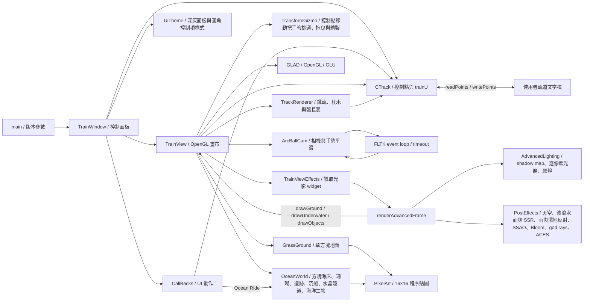

# 架構與資料流

`TrainWindow` 持有場景狀態與 widget；`TrainView` 讀取場景與 UI 選項並繪圖。
`TrackRenderer` 建立累積弧長表，依弧長等距擺放枕木，並以程式產生的像素材質畫方塊風鐵軌；`makeTrackFrame()` 也放在這裡，供列車與相機共用。
`CallBacks` 處理按鈕、軌道載入儲存與列車更新。
`TrainView::handle()` 處理控制點編輯：`TransformGizmo` 以上一幀的相機矩陣做純數學運算（滑鼠射線對軸取最近點、對平面取交點），
不需要 OpenGL context，所以由 `GizmoDragCheck` 測試；編輯進行中的事件會先於相機處理，結果同步到 `Transform` 面板。
`ArcBallCam` 用 FLTK timeout 分攤旋轉與縮放，Windows 特定觸控處理位於 `TrainView.cpp`。
`Utilities` 包含相機、幾何點與 OpenGL 輔助函式。

`Light+` 開啟時，`TrainView::draw()` 改呼叫 `renderAdvancedFrame()`：
先從太陽方向把物體畫進 2048² 深度貼圖（shadow map），水面開啟時再以水平面鏡射相機畫一次反射，
接著把場景畫進 16-bit 浮點 frame buffer，依序做 SSAO、濕地反射（下雨時）、水面、雨絲、Bloom 與 god rays，最後 ACES 色調映射到視窗。
水面是跟著鏡頭移動的細分網格：頂點 shader 疊加 Gerstner 波位移，片段 shader 用同一組波的解析法線加上多層捲動噪點；
倒影先在螢幕空間沿反射方向對深度緩衝做光線步進（SSR），沒打中時用平面反射，再依 Schlick 菲涅耳與折射混合。
`Rain` 經 `TrainViewEffects` 緩慢改變 `LightingFrame` 的 `rain` 與 `wetness`：天空轉陰，光照 shader 讓濕表面變暗並提高高光，
水窪遮罩內另以全螢幕 pass 重用同一段 SSR 做鏡面反射，水面法線加上雨滴漣漪。
光照 shader 是 GLSL 1.20，直接讀固定管線的 `gl_Vertex`、`gl_Normal`、`gl_Color` 與 texture unit 0，所以既有 `glBegin` 繪圖程式不需修改；
未綁貼圖時 unit 0 的預設 texture 0 是一個白色 texel。shader 或 frame buffer 建立失敗時自動退回原本畫法。

`Water` 開啟時另外畫 `OceanWorld`：海床是 128×14×128 的方塊格，建好後編成 display list。
建置時先算 Minecraft 式的光照：天光沿開放的柱子直灌而下、每往旁邊一格少一級，水晶自己發光，
角落再加 ambient occlusion，結果放進 texture unit 1 的座標（x 發光、y 擺動、z 水晶光、w 天光），所以隧道深處自然變暗。
岩拱、閘門與隧道是沿著 `Ocean Ride` 的三種 spline 挖出來的，植物另外避開軌道周圍的淨空帶，
`OceanWorld::rideObstructions()` 與測試 `OceanRideClearanceCheck` 用正式的 `CTrack` 取樣檢查列車不會碰到方塊或植物。
魚群、鯊魚、海龜、魟魚、鯨魚與水母每格以方塊即時畫出，大型生物只在景物高度上限之上活動。
光照 shader 對水面以下的像素依深度吸收陽光（紅光最先消失）並乘上 caustics；
鏡頭在水下時改走水下流程：不畫反射，水面改從下方畫（Snell 窗），加上漂浮微粒與氣泡，
再以半解析度沿視線 ray march shadow map 算出光束，最後全解析度套上水霧。
caustics、吸收係數與水體顏色放在 `UnderwaterOptics.h`，三個 shader 共用；水下光束 pass 同時算出頭燈的光錐。

軌道格式首行為控制點數，其後每行是位置 `x y z` 與可選方向 `x y z`。
載入後 `trainU` 歸零。個人資料與來源程式分開保存；應以複本驗證讀取與還原。

工程決策見 [ADR 0001](adr/0001-windows-quality-gates.md)。
Clang 工具鏈選擇見 [ADR 0002](adr/0002-clang-cl-build.md)。
