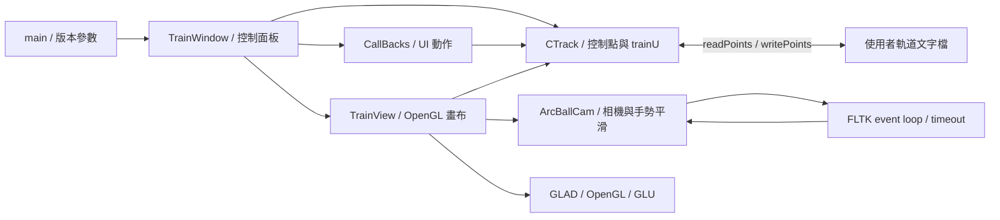

# 架構與資料流

`TrainWindow` 持有場景狀態與 widget；`TrainView` 讀取場景與 UI 選項並繪圖。
`CallBacks` 處理按鈕、軌道載入儲存與列車更新。
`ArcBallCam` 用 FLTK timeout 分攤旋轉與縮放，Windows 特定觸控處理位於 `TrainView.cpp`。
`Utilities` 包含相機、幾何點與 OpenGL 輔助函式。

軌道格式首行為控制點數，其後每行是位置 `x y z` 與可選方向 `x y z`。
載入後 `trainU` 歸零。個人資料與來源程式分開保存；應以複本驗證讀取與還原。

工程決策見 [ADR 0001](adr/0001-windows-quality-gates.md)。
Clang 工具鏈選擇見 [ADR 0002](adr/0002-clang-cl-build.md)。
