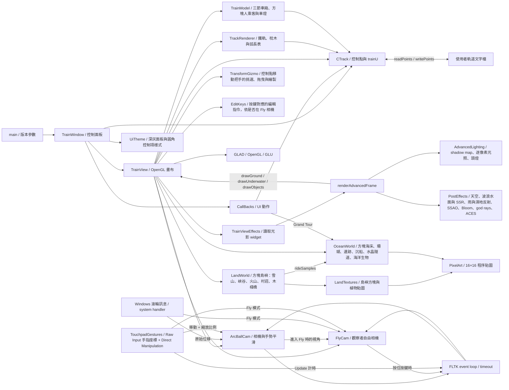

# 架構與資料流

`TrainWindow` 持有場景狀態與 widget；`TrainView` 讀取場景與 UI 選項並繪圖。
`TrackRenderer` 建立累積弧長表，依弧長等距擺放枕木，並以程式產生的像素材質畫方塊風鐵軌；`makeTrackFrame()` 也放在這裡，供列車與相機共用。
`CallBacks` 處理按鈕、軌道載入儲存與列車更新。
`TrainView::handle()` 處理控制點編輯：`TransformGizmo` 以上一幀的相機矩陣做純數學運算（滑鼠射線對軸取最近點、對平面取交點），
不需要 OpenGL context，所以由 `GizmoDragCheck` 測試；編輯進行中的事件會先於相機處理，結果同步到 `Transform` 面板。
哪個鍵是哪個編輯指令由 `EditKeys::forKey()` 決定：Fly 相機下避開所有飛行鍵（複製改 `Alt` + `D`、刪除只留 `Delete`），
所以 Fly 模式的 `handle()` 先問 `editKey()`、再交給 `FlyCam`，飛行鍵不會被編輯搶走，`Home` 取代 `R` 回到 World 視角。編輯開始時 `FlyCam` 停止並解除滑鼠鎖定；編輯中 `editEvent()` 只吃按下，按鍵放開（`FL_KEYUP`）仍交給 `FlyCam`。掃描碼 system handler 也送出 `G`、`R` 與 `Home`，並以 `GetKeyState` 補上修飾鍵狀態，兩條路徑的鍵位一致。`EditKeysCheck` 測試這張對照表與正式 `FlyCam` 不衝突。
`ArcBallCam` 用 FLTK timeout 分攤滑鼠滾輪的整格縮放（左右傾斜為旋轉）；觸控板的細小位移則立即套用。FLTK 1.3 會把滾輪訊息捨入為整格，因此 `TrainView.cpp` 以 system handler 直接讀取 Windows `WM_MOUSEWHEEL`／`WM_MOUSEHWHEEL` 的原始位移。
`FlyCam` 是 Fly 相機按鈕的觀察者模式：記錄位置、yaw 與 pitch（水平線固定），按住移動鍵時以 FLTK timeout 依實際經過時間移動，因此速度單位是每秒世界單位，與幀率無關。第一次進入時 `TrainView` 讀回 World 相機的 modelview 矩陣作為起點，並依兩者視角差沿視線移動，使畫面不跳動。失去焦點或切換相機時清除按住的按鍵，避免相機持續漂移。為了不迷失方向，`FlyCam` 把相機限制在場景周圍的方框內（`TrainView` 以 `setGround()` 把最低點設為 y = −200，可以跟著潛到地面以下的軌道），按鍵前進保持水平，並提供平滑的 `lookAt()`（F 鍵轉向列車）；Fly 模式下 `TrainView` 另外畫中央準星，`Light+` 關閉時再畫延伸到地平線的地面（開啟時已有天空與海面），並關閉觸控板放開後的慣性旋轉。操作仿照方塊遊戲的觀察者模式：在畫面點一下後 `TrainView` 隱藏游標、以 `ClipCursor` 限制在畫面內，每次 `FL_MOVE` 把游標相對中心的位移交給 `FlyCam::mouseLook()` 再用 `SetCursorPos` 拉回中心；Esc、失去焦點或切換相機時放開。滑鼠滾輪改變飛行速度。Fly 模式下 `TrainView` 以 `ImmAssociateContextEx` 關閉視窗的輸入法，並另掛一個 FLTK system handler，依 `WM_KEYDOWN`／`WM_KEYUP` 的掃描碼（`FlyCam::keyForScanCode()`）把飛行按鍵直接交給 `TrainView::handle()`，因此注音等輸入法把按鍵變成 `VK_PROCESSKEY` 時，或使用其他鍵盤配置時，按鍵位置仍然有效。
`TouchpadGestures` 以 Raw Input 讀取精準觸控板每根手指的座標，自行把兩指的共同位移與張開比例同時送給 `ArcBallCam`（Fly 模式送給 `FlyCam`：轉頭與前進同時作用）；Direct Manipulation 只負責接手手勢，避免 Windows 另外送出滾輪訊息，並在原始報告不可用時作為備援。見 [ADR 0003](adr/0003-touchpad-direct-manipulation.md)。
`Utilities` 包含相機、幾何點與 OpenGL 輔助函式。

`Light+` 開啟時，`TrainView::draw()` 改呼叫 `renderAdvancedFrame()`：
先從太陽方向把物體畫進 2048² 深度貼圖（shadow map），水面開啟時再以水平面鏡射相機畫一次反射，
接著把場景畫進 16-bit 浮點 frame buffer，依序做 SSAO、濕地反射（下雨時）、水面、雨絲、Bloom 與 god rays，最後 ACES 色調映射到視窗。
水面是跟著鏡頭移動的細分網格：頂點 shader 疊加 Gerstner 波位移，片段 shader 用同一組波的解析法線加上多層捲動噪點；
倒影先在螢幕空間沿反射方向對深度緩衝做光線步進（SSR），沒打中時用平面反射，再依 Schlick 菲涅耳與折射混合。
`Rain` 經 `TrainViewEffects` 緩慢改變 `LightingFrame` 的 `rain` 與 `wetness`：天空轉陰，光照 shader 讓濕表面變暗並提高高光，
水窪遮罩內另以全螢幕 pass 重用同一段 SSR 做鏡面反射，水面法線加上雨滴漣漪。
光照 shader 是 GLSL 1.20，直接讀固定管線的 `gl_Vertex`、`gl_Normal`、`gl_Color` 與 texture unit 0，所以既有 `glBegin` 繪圖程式不需修改；
未綁貼圖時 unit 0 的預設 texture 0 是一個白色 texel。shader 或 frame buffer 建立失敗時自動退回原本畫法。

`Water` 開啟時另外畫 `OceanWorld`：海床是 128×14×128 的方塊格，建好後編成 display list。
建置時先算 Minecraft 式的光照：天光沿開放的柱子直灌而下、每往旁邊一格少一級，水晶自己發光，
角落再加 ambient occlusion，結果放進 texture unit 1 的座標（x 發光、y 擺動、z 水晶光、w 天光），所以隧道深處自然變暗。
岩拱、閘門與隧道是沿著 `Grand Tour` 的三種 spline 挖出來的，植物另外避開軌道周圍的淨空帶，
`OceanWorld::rideObstructions()` 與測試 `OceanRideClearanceCheck` 用正式的 `CTrack` 取樣檢查列車不會碰到方塊或植物。
魚群、鯊魚、海龜、魟魚、鯨魚與水母每格以方塊即時畫出，大型生物只在景物高度上限之上活動。
牠們的位置是時間的函數，不需保存狀態：沿軌道的魚群取軌道曲線上方的位置（軌道周圍已挖空，必定是開放水域），
開闊水域的魚群與大型生物用幾個週期互不整除的正弦波相加，在各自的橢圓水域內不重複地遊走且不會游出範圍；魚群成員保持隊形並朝同一方向。
光照 shader 對水面以下的像素依深度吸收陽光（紅光最先消失）並乘上 caustics；
鏡頭在水下時改走水下流程：不畫反射，水面改從下方畫（Snell 窗），加上漂浮微粒與氣泡，
再以半解析度沿視線 ray march shadow map 算出光束，最後全解析度套上水霧。
caustics、吸收係數與水體顏色放在 `UnderwaterOptics.h`，三個 shader 共用；水下光束 pass 同時算出頭燈的光錐。

`Grand Tour` 的控制點定義在 `OceanWorld`（前 25 點是海底段，其後是陸地段），`OceanWorld::rideSamples()` 把整圈以三種 spline 取樣。
`LandWorld` 用這些取樣點建島：先由雜訊與幾個地形函式（雪山、火山與火山口、岩山、惡地台地與峽谷）算出每一格的高度與生態，
填入方塊後放上熔岩湖與熔岩河、溪流與瀑布、村莊、池塘與漂浮島，再沿路線挖出淨空管（比列車需要的空間大），
挖剩的薄頂會移除、軌道正下方鋪碎石，有頂的路段在牆上嵌燈籠或水晶，最後才種樹與花草（只種在淨空帶之外）。
光照烘焙與 `OceanWorld` 相同（天光、發光方塊、ambient occlusion）；熔岩與燈籠的暖光寫進頂點顏色與發光量，水晶的冷光用 shader 既有的方塊光。
`LandWorld::rideObstructions()` 與測試 `LandRideClearanceCheck` 用正式的 `CTrack` 取樣，檢查三種 spline 下列車都不會碰到方塊或植物。
會動的東西（瀑布水流、風車、動物、雲、熱氣球）每格以方塊即時畫出；`drawSupports()` 依目前軌道每 9 單位立一座木棧橋，
從軌道往下找到地面，下方有另一段軌道或熔岩時不立。山體也畫進 shadow map，所以會投影。
`Scenery` 關閉時 `LandWorld` 改建平坦的編輯用島；固定管線（`Light+` 關閉）的平面陰影只在這個模式使用。
`Train`／`Chase` 相機由 `TrainView::setProjection()` 從軌道座標系算出。

軌道格式首行為控制點數，其後每行是位置 `x y z` 與可選方向 `x y z`。
載入後 `trainU` 歸零。個人資料與來源程式分開保存；應以複本驗證讀取與還原。

工程決策見 [ADR 0001](adr/0001-windows-quality-gates.md)。
Clang 工具鏈選擇見 [ADR 0002](adr/0002-clang-cl-build.md)。
