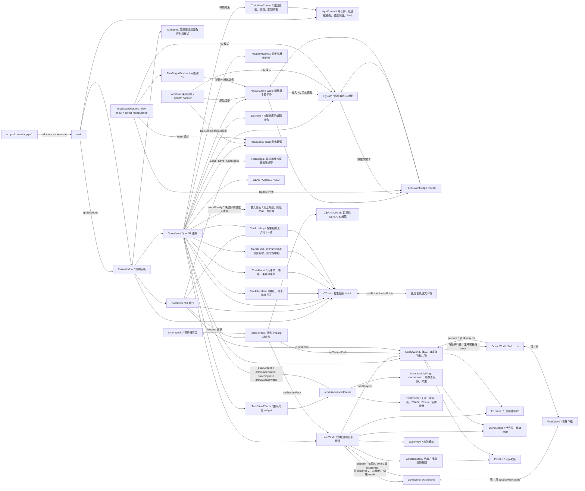

# 架構與資料流

本文件說明模組責任、事件與資料流，以及跨模組必須維持的約定。
各景物的尺寸、配色與擺放規則寫在對應函式的註解裡，不在此重複；操作方式見 [README](../README.md)。

## 模組責任

| 路徑 | 職責 |
|---|---|
| `src/main.cpp` | 解析命令列，切到 exe 所在資料夾，建立 `TrainWindow` 並啟動 FLTK 事件迴圈；自動模式結束後回傳結果。 |
| `src/AppControl.h/.cpp` | 命令列（`--doctor`、`--screenshot` 與場景參數）的解析、軌道檔格式檢查、資料夾檢查、畫面判讀與 PNG 寫入；不需要視窗，由 `AppControlCheck` 測試。 |
| `src/TrainViewControl.cpp` | 自動模式下每幀結束時：`--doctor` 回報 OpenGL 與 shader 路徑，`--screenshot` 從 back buffer 讀回畫面、存檔並判斷是否真的畫出東西，然後關閉視窗。 |
| `src/TrainWindow.H/.cpp` | 主視窗與控制面板；持有唯一的 `CTrack`、widget 與 `advanceTrain()`。 |
| `src/CallBacks.H/.cpp` | 按鈕、滑桿、idle 更新、軌道載入儲存與材質包選單。 |
| `src/UiTheme.h/.cpp` | 控制面板配色與圓角控制項樣式。 |
| `src/TrainView.H/.cpp` | OpenGL 畫布：相機投影、場景繪製、控制點選取與編輯、Windows 輸入訊息。 |
| `src/TrainViewEffects.cpp` | 把光影 widget 的狀態轉成 `LightingFrame`，並呼叫 `renderAdvancedFrame()`。 |
| `src/AdvancedLighting.h/.cpp` | 跟著鏡頭的 shadow map、GLSL 逐像素光照、日夜與頭燈。 |
| `src/PostEffects.h/.cpp` | 浮點 frame buffer 與後製：天空、水面與 SSR、雨與濕地反射、SSAO、Bloom、god rays、ACES。 |
| `src/UnderwaterOptics.h` | 水下吸收、caustics 與水色常數，三個 shader 共用。 |
| `src/LandWaterMotion.h` | 島上的水怎麼動（水面輕微起伏、落水處攪動、瀑布朝空氣的面輕微擺動），光照 shader 與水面 shader 共用，依 `LandWorld` 寫在頂點上的標記。 |
| `src/MatrixMath.h` | 光影程式用的 column-major 4×4 矩陣輔助函式。 |
| `src/Track.H/.cpp` | 控制點容器、三種樣條的位置與切線、`trainU`、軌道文字檔讀寫。 |
| `src/ControlPoint.H/.cpp` | 控制點位置、方向向量與標記繪製。 |
| `src/TrackRenderer.H/.cpp` | 鐵軌與枕木繪製、累積弧長表、`makeTrackFrame()`。 |
| `src/TrainModel.h/.cpp` | 列車模型；`Chase` 相機用的列車長度與沿軌道往回取點。 |
| `src/TransformGizmo.h/.cpp` | 控制點移動把手的挑選、拖曳換算（純數學）與繪製。 |
| `src/TrackInsert.h/.cpp` | 找出點擊處的軌道參數，在該處插入控制點（軌道仍經過點擊處）、刪除控制點並重新對應 `trainU`；純數學，由 `TrackInsertCheck` 測試。 |
| `src/TrackHistory.h/.cpp` | 控制點的上一步／下一步：每次修改前存一份整條軌道（點、`trainU`、選取）的快照；由 `TrackHistoryCheck` 測試。 |
| `src/EditKeys.h/.cpp` | 編輯指令的鍵位表；Fly 相機下避開飛行鍵。 |
| `src/LandWorld.h/.cpp` | 方塊島嶼：地形與生態、建築、水、沿 `Grand Tour` 挖出淨空、光照烘焙、會動的景物、木棧橋；在背景執行緒建造。 |
| `src/WorldSave.h` | 島與海床網格的存檔（`data/saves/*.world`，run-length 編碼），key 是生成程式的建置時間與網格尺寸。 |
| `src/CellQueue.h` | 光照 flood fill 用的單一 vector 佇列（取代 MSVC Debug 下很慢的 `std::deque`）。 |
| `src/LandTextures.h/.cpp` | 島嶼方塊與植物的程序貼圖。 |
| `src/OceanWorld.h/.cpp` | 海床、海底景物、海洋生物，以及 `Grand Tour` 的控制點與取樣。 |
| `src/WorldShape.h/.cpp` | 世界尺寸、放大倍率與海岸線（陸地與海底共用）。 |
| `src/WaterFlow.h/.cpp` | 方塊遊戲式的水流擴散規則。 |
| `src/Frustum.h/.cpp` | 從目前矩陣取出視錐平面，做分塊剔除。 |
| `src/PixelArt.h/.cpp` | 程序貼圖的雜湊、繪圖與上傳輔助函式。 |
| `src/TexturePack.h/.cpp` | 找出並開啟材質包，對照方塊名稱、染色並交出貼圖。 |
| `src/ZipArchive.h/.cpp` | 讀取 zip 目錄，以自己的 DEFLATE 解碼器解壓。 |
| `src/FileDialogs.h/.cpp` | 系統檔案視窗（`Fl_Native_File_Chooser`）與用檔案總管開資料夾。 |
| `src/TouchpadGestures.H/.cpp` | Raw Input 讀精準觸控板的手指座標；Direct Manipulation 接手手勢並作為備援。 |
| `src/Utilities/TwoFingerGesture.*` | 兩指位移與張開比例的 1-euro 濾波與起動門檻。 |
| `src/Utilities/ArcBallCam.*` | World 相機；以 FLTK timeout 分攤滾輪縮放。 |
| `src/Utilities/FlyCam.*` | Fly 觀察者相機。 |
| `src/Utilities/HeadLook.*` | Train 相機相對於列車的轉頭。 |
| `src/Utilities/Pnt3f.*`、`3DUtils.*` | 三維向量型別與 OpenGL 輔助函式（課程原始碼）。 |

## 事件與更新

- 控制面板 callback 直接修改 `TrainWindow::m_Track`，再呼叫 `damageMe()` 要求重畫。
- `Run` 開啟時，FLTK idle callback `runButtonCB()` 最多每秒 30 次呼叫 `advanceTrain()`；左右鍵以正負方向呼叫同一函式。
- `ArcLength` 開啟時，`advanceByArcLength()` 沿參數小步前進、累加歐氏距離，每次呼叫即時計算；關閉時直接改變 `trainU`，所以世界空間速度會隨區段長度變化。
- 光影動畫（雨、時間）由每秒 30 次的 `animateEffectsCB` timeout 推進。
- 世界在背景執行緒建造：`TrainView::draw()` 先呼叫 `worldReady()`，它對目前要畫的島與（`Water` 與 `Light+` 都開時）海床呼叫 `prepare()`。第一次呼叫時各開一條 `std::thread` 生成網格並逐塊產生頂點；display list 只能在主執行緒建立，所以 `prepare()` 每幀最多花約 30 ms 編譯已完成的塊，其餘時間畫載入畫面，並以 timeout 約每 1/30 秒重畫，直到全部完成。
- 新增控制點（`Add Pt`、`Shift` + `D`）先進入放置模式，`TrackInsert::pick()` 找滑鼠附近的軌道參數，點下時 `insertAt()` 插點並進入拖曳。Fly 相機在滑鼠鎖定且 `Edit` 開啟時是建造狀態（`flyBuilding()`）：左鍵刪準心對到的點、中鍵或 `C` 選取、右鍵在準心前方放點；`G` 以 `beginCarry()`／`updateCarry()` 讓點跟著視角移動。
- 修改控制點的每條路徑（新增、刪除、`Load`、`Reset`、`Grand Tour`、R±X／Z、`Transform` 欄位、拖曳與 `G`／`R`）都先存 `TrackHistory` 快照；拖曳只在點真的改變時才存入。
- 相機的平滑、按住按鍵移動與觸控板慣性都走 FLTK timeout，依實際經過時間計算，與幀率無關。
- 自動模式（`--doctor`／`--screenshot`）：`main()` 先以 `TrainWindow::applyOptions()` 設定場景（軌道檔先經 `checkTrackFile()`，壞檔直接失敗、不跳對話框），`TrainView::draw()` 畫完 `drawFrame()` 後呼叫 `finishAutomatedFrame()`。`--doctor` 在第一幀就回報；`--screenshot` 只計算真正畫出場景的幀（`frameShowsScene`，載入畫面不算），達到指定幀數才讀回畫面、寫 PNG、印出 `PASS`／`FAIL` 行與場景出現所花的秒數，再關閉視窗讓 `Fl::run()` 返回。300 秒內場景沒有出現也算失敗。結束碼：0 通過、1 檢查失敗、2 命令列錯誤。

## 跨模組約定

改動下列任一項時，要同時檢查所列的其他模組與測試。

**座標與樣條**
- 世界座標 Y 軸朝上；列車模型本地 +Z 是車頭方向。
- `trainU` 是樣條參數，不是距離；每個整數區段對應一個控制點區段，依控制點數回繞成閉環。少於 4 點時位置回傳原點，編輯操作會維持至少 4 點。
- Linear、Cardinal（Catmull-Rom）與 B-spline（預設）共用參數週期與閉環索引。
- `evaluateTangent()` 以 `u ± 0.001` 差分估算；`makeTrackFrame()` 以世界上方協助建立方向框架，車體、鐵軌與 Train／Chase 相機共用。遇到完整翻轉的軌道，側向會突然翻轉，屆時要改用平行傳輸框架。
- 列車方向由切線決定；`ControlPoint::orient` 會存檔，但目前不參與計算。

**相機**
- 所有透視相機共用 `FOV` 滑桿的視角（`TrainView::setFieldOfView()`），所以切到 Fly 時直接沿用上一幀的 modelview 矩陣，畫面不跳動；上一幀是 Top 時改從 `topViewCentre()` 上方往下看。
- Fly 與 Train 模式的按鍵經掃描碼 system handler（`FlyCam::keyForScanCode()`）送進 `TrainView::handle()`，輸入法開啟或使用其他鍵盤配置時按鍵位置仍有效。編輯鍵由 `EditKeys::forKey()` 決定，不能與飛行鍵衝突（`EditKeysCheck`）。
- FLTK 1.3 會把滾輪訊息捨入為整格，所以 `TrainView.cpp` 直接讀 `WM_MOUSEWHEEL`／`WM_MOUSEHWHEEL` 的原始位移。觸控板的設計見 [ADR 0003](adr/0003-touchpad-direct-manipulation.md)。

**場景與列車淨空**
- `Grand Tour` 的控制點以最初的座標寫在 `OceanWorld`，取用時乘上 `WorldShape::kScale`（水平）與 `kLift`（海面以上高度）。
- 陸地與海底都沿 `rideSamples()` 的三種樣條挖出淨空；`LandWorld::rideObstructions()`、`waterNearRide()` 與 `OceanWorld::rideObstructions()` 以正式 `CTrack` 檢查，對應測試是 `LandRideClearanceCheck` 與 `OceanRideClearanceCheck`。新增景物必須避開淨空。
- 海岸線由 `WorldShape::inland()` 決定，陸地與海底共用，兩邊才會吻合。
- 海洋生物與會動的景物，位置都是時間的函數，不保存狀態。
- 世界存檔的 key 由影響該世界的每個原始檔以 `buildStamp()` 回傳編譯時間組成：重新編譯生成程式就會重新生成，檔案損壞或格式不符時當作沒有存檔。改變生成結果的修改必須讓 key 改變。存檔先寫 `.tmp` 再改名。

**繪製**
- 島與海床以 16×16 欄為一塊，各自編成 display list；`Frustum` 用當下的矩陣剔除，所以陰影與反射 pass 也只畫自己看得到的塊。
- 顯示清單綁定貼圖名稱：換材質包時只改寫貼圖內容（`PixelArt::uploadInto()`），不重建島嶼。
- 場景中的每種方塊與植物都要對應到材質包對照表裡的方塊名稱；只有生物、雲、熱氣球、鐵軌與列車維持程式自己的顏色。小構件（樓梯、半磚、柵欄、燈籠等）放在植物格，見 [ADR 0006](adr/0006-building-parts-in-plant-cells.md)。材質包格式見 [ADR 0005](adr/0005-texture-packs.md)。
- 光照烘焙（天光、發光方塊、ambient occlusion）寫進頂點的 texture unit 1 座標；依朝向的明暗一律由 shader 依法線計算，不寫進頂點顏色，否則會暗兩次。
- 光照 shader 是 GLSL 1.20，直接讀固定管線的 `gl_Vertex`、`gl_Normal`、`gl_Color` 與 texture unit 0，既有的 `glBegin` 繪圖不需修改。shader 或 frame buffer 建立失敗時自動退回固定管線。
- 場景 frame buffer 的 alpha 存「對天空的開放程度」，供濕地反射使用；所以開啟 shader 時植物不能用 alpha test。
- 半透明的水與玻璃最後畫：先寫深度，再在最近的水面混合顏色，不進 shadow map。有後製時，島上的水不在場景裡畫，改由 `PostEffects::drawSurfaceWater()` 在海面之後用海的 shader 畫（`SceneCallbacks::waterLater` 期間 `drawObjects()` 略過它；倒影 pass 仍畫貼圖的水）。
- `Scenery` 關閉時改建平坦的編輯用島；固定管線的平面陰影只在這個模式使用。

## 軌道檔

第一行是控制點數（4–65535），之後每行是 `x y z`，或 `x y z orientX orientY orientZ`；未提供方向時使用 `(0, 1, 0)`。
載入後 `trainU` 歸零。格式變更必須維持舊檔可讀，`TrackRoundTripCheck` 以正式讀寫函式驗證；備份與還原流程見 [維運文件](operations.md)。

## 擴充方向

目前 `TrainWindow` 只持有一條 `CTrack`，`TrainView::drawStuff()` 直接列出要畫的東西。加入多條軌道或其他遊樂設施前，建議先把世界狀態從視窗移出（例如 `ParkWorld` 持有軌道、設施與景物集合），每種設施各自實作 `update(dt)` 與 `draw(renderPass)`，不要把特定設施的邏輯塞進 `TrainView`；速度也應改用實際時間差 `dt`。

工程決策見 [ADR 0001](adr/0001-windows-quality-gates.md)；Clang 工具鏈見 [ADR 0002](adr/0002-clang-cl-build.md)；Visual Studio 版本見 [ADR 0004](adr/0004-any-visual-studio-version.md)。
