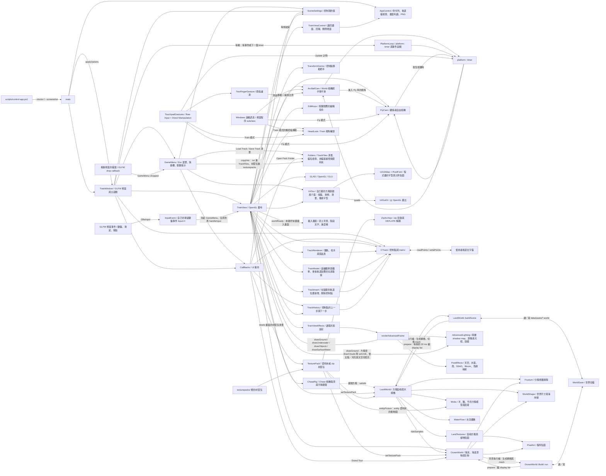

# 架構與資料流

本文件說明模組責任、事件與資料流，以及跨模組必須維持的約定。
各景物的尺寸、配色與擺放規則寫在對應函式的註解裡，不在此重複；操作方式見 [README](../README.md)。

## 模組責任

| 路徑 | 職責 |
|---|---|
| `src/main.cpp` | 解析命令列，切到 exe 所在資料夾，建立 `TrainWindow`、開啟視窗並執行 `run()`；自動模式結束後回傳結果。 |
| `src/AppControl.h/.cpp` | 命令列（`--doctor`、`--screenshot` 與場景參數）的解析、軌道檔格式檢查、資料夾檢查、畫面判讀與 PNG 寫入；不需要視窗，由 `AppControlCheck` 測試。 |
| `src/TrainViewControl.cpp` | 自動模式下每幀結束時：`--doctor` 回報 OpenGL 與 shader 路徑，`--screenshot` 從 back buffer 讀回畫面、存檔並判斷是否真的畫出東西，然後關閉視窗。 |
| `src/TrainWindow.H/.cpp` | GLFW 視窗（OpenGL 相容 context、IME 關閉、滾輪訊息先經自己的視窗程序）與主迴圈 `run()`；持有唯一的 `CTrack`、`SceneSettings`、`GameMenu`、上一步歷史與 `advanceTrain()`。GLFW callback 經 `GlfwInput` 轉成 `InputEvent`，先給 `GameMenu`，沒用到才給 `TrainView`。見 [ADR 0010](adr/0010-glfw-window-and-game-menu.md)。 |
| `src/GameMenu.h/.cpp` | 用 `Ui/Gui` 畫出的介面：左上角按鍵提示、九格快捷欄、狀態列，啟動時的標題畫面（`Title`，背後的世界在背景建造或慢慢轉動；`SelectWorld` 選島或平地，由 `CallBacks` 的 `playIsland()`／`playFlat()` 切換；`Options` 進設定畫面），以及 Esc 打開的選單（`Pause`、`Ride`、`Camera`、`Track`、`Lighting`、`World`、`Load Track`、`Save Track`），和取代系統訊息視窗的 `notify()`（訊息與 OK）、`confirm()`（Yes／No）；全部只讀寫 `SceneSettings` 與呼叫 `CallBacks`。 |
| `src/SceneSettings.h` | 控制項目前的值：Run、速度、ArcLength、相機（`CameraView`）、曲線種類、Edit、光影開關、時間、水、雨、景物。介面（`GameMenu`）、`TrainView` 與 callback 都只讀寫這裡。 |
| `src/CallBacks.H/.cpp` | 選單按鈕與快捷欄的動作：新增刪除控制點、步進、軌道載入儲存、Reset、Grand Tour、材質包。 |
| `src/Ui/Gui.h/.cpp` | 方塊遊戲風的即時模式介面：每幀呼叫 `button()`、`toggle()`、`cycle()`、`slider()`、`list()` 同時畫出元件並回報是否被使用；滑鼠以 `feed()` 在幀之間送入（按下即觸發），`feed()` 回報介面是否吃掉事件；GUI 縮放照方塊遊戲的 Auto（至少留 320 x 240 單位）。不需 OpenGL，由 `GuiCheck` 測試。見 [ADR 0009](adr/0009-own-block-game-style-ui.md)。 |
| `src/Ui/PixelFont.h/.cpp`、`UiAtlas.h/.cpp` | 自己畫的 ASCII 像素字型（最寬 5、高 7 加一行下伸）與元件貼圖（按鈕三態、滑桿槽、面板、快捷欄格子、快捷欄圖示），合成一張 256 x 256 atlas，以九宮格伸縮。 |
| `src/Ui/GuiGl.h/.cpp` | 上傳 atlas（nearest 取樣）並以像素座標畫出 `Gui` 的 quads；GL context 重建時 `forget()`。載入畫面、選單與快捷欄都由它畫。 |
| `src/TrainView.H/.cpp` | OpenGL 畫面：相機投影、場景繪製、控制點選取與編輯、滑鼠鎖定、觸控板與滾輪訊息；狀態文字交給 `GameMenu` 畫在快捷欄上方。 |
| `src/TrainViewEffects.cpp` | 把 `SceneSettings` 的光影設定轉成 `LightingFrame`，並呼叫 `renderAdvancedFrame()`。 |
| `src/AdvancedLighting.h/.cpp` | 跟著鏡頭的兩層 shadow map（鏡頭附近 150 單位的細圖、外圍 600 單位的粗圖，交界處混合）、GLSL 逐像素光照、日夜與頭燈。`setUnlit(true)` 讓不該依法線明暗的東西（方塊雲）一律用天空光加太陽或月亮的光色照亮，跟著時間與下雨變化。 |
| `src/PostEffects.h/.cpp` | 浮點 frame buffer 與後製：天空、水面與 SSR、雨與濕地反射、SSAO、Bloom、god rays、ACES。 |
| `src/UnderwaterOptics.h` | 水下吸收、caustics 與水色常數，三個 shader 共用。 |
| `src/LandWaterMotion.h` | 島上的水怎麼動（水面輕微起伏、落水處攪動、瀑布朝空氣的面輕微擺動），光照 shader 與水面 shader 共用，依 `LandWorld` 寫在頂點上的標記。 |
| `src/MatrixMath.h` | 光影程式用的 column-major 4×4 矩陣輔助函式。 |
| `src/Track.H/.cpp` | 控制點容器、三種樣條的位置與切線、`trainU`、軌道文字檔讀寫。 |
| `src/ControlPoint.H/.cpp` | 控制點位置、方向向量與標記繪製。 |
| `src/TrackRenderer.H/.cpp` | 鐵軌與枕木繪製、累積弧長表、`makeTrackFrame()`。 |
| `src/TrainModel.h/.cpp` | 列車模型；`Chase` 相機用的列車長度、乘客高度與沿軌道往回取點。 |
| `src/ChaseRig.h/.cpp` | `Chase` 相機的取景數學（純計算）：依列車長度、乘客高度與視野算出在車後多遠、多高，空間不夠時降低並拉近，平滑跟隨，以及拖曳時繞列車中段轉動（`orbit()`）；由 `ChaseRigCheck` 測試。`TrainView` 用另一個 `HeadLook`（`chaseLook`）記錄轉動角度，轉到方塊後時把鏡頭拉近到方塊前。`TrainView` 把它放到軌道上，並用 `LandWorld::solidAt()`／`OceanWorld::solidAt()` 避開方塊。 |
| `src/TransformGizmo.h/.cpp` | 控制點移動把手的挑選、拖曳換算（純數學）與繪製。 |
| `src/TrackInsert.h/.cpp` | 找出點擊處的軌道參數，在該處插入控制點（軌道仍經過點擊處）、刪除控制點並重新對應 `trainU`；純數學，由 `TrackInsertCheck` 測試。 |
| `src/TrackHistory.h/.cpp` | 控制點的上一步／下一步：每次修改前存一份整條軌道（點、`trainU`、選取）的快照；由 `TrackHistoryCheck` 測試。 |
| `src/EditKeys.h/.cpp` | 編輯指令的鍵位表；Fly 相機下避開飛行鍵。 |
| `src/LandWorld.h/.cpp` | 方塊島嶼：地形與生態、建築、水、沿 `Grand Tour` 挖出淨空、光照烘焙、會動的景物、木棧橋；在背景執行緒建造。方塊雲由 `drawClouds()` 另外畫（沒有自發光），`TrainView::drawGround()` 在它前後開關 `AdvancedLighting::setUnlit()`。 |
| `src/WorldSave.h` | 島與海床網格的存檔（`data/saves/*.world`，run-length 編碼），key 是生成程式的建置時間與網格尺寸。 |
| `src/CellQueue.h` | 光照 flood fill 用的單一 vector 佇列（取代 MSVC Debug 下很慢的 `std::deque`）。 |
| `src/LandTextures.h/.cpp` | 島嶼方塊與植物的程序貼圖。 |
| `src/Mobs.h/.cpp` | 島上的羊、豬、牛：照方塊遊戲模型以像素為單位的方塊與其貼圖配置（box UV）、內建皮膚、上傳與繪製；由 `MobsCheck` 測試模型每一面都落在皮膚上。 |
| `src/OceanWorld.h/.cpp` | 海床、海底景物、海洋生物，以及 `Grand Tour` 的控制點與取樣。 |
| `src/WorldShape.h/.cpp` | 世界尺寸、放大倍率與海岸線（陸地與海底共用）。 |
| `src/WaterFlow.h/.cpp` | 方塊遊戲式的水流擴散規則。 |
| `src/Frustum.h/.cpp` | 從目前矩陣取出視錐平面，做分塊剔除。 |
| `src/PixelArt.h/.cpp` | 程序貼圖的雜湊、繪圖與上傳輔助函式。 |
| `src/TexturePack.h/.cpp` | 找出並開啟材質包，對照方塊名稱、染色並交出貼圖；PNG 以 stb_image 解碼。 |
| `src/ZipArchive.h/.cpp` | 讀取 zip 目錄，以自己的 DEFLATE 解碼器解壓。 |
| `src/Folders.h/.cpp` | 遊戲內清單用的資料夾工具：列出某副檔名的檔案（不分大小寫排序）、Windows 能不能用這個檔名、補副檔名、建立資料夾、用檔案總管打開資料夾、把拖進視窗的檔案或資料夾複製進來（同名不同內容時取名 `loop (2).txt`）；由 `FoldersCheck` 測試。見 [ADR 0011](adr/0011-in-game-track-list-and-notices.md)、[ADR 0013](adr/0013-drop-files-on-the-window.md)。程式裡的路徑一律是 UTF-8：`main()` 把命令列轉成 UTF-8，檔案以 `Utilities/Utf8File.H` 的 `openUtf8()` 開啟（Windows 上用寬字元），中文檔名的軌道也能存讀。 |
| `src/TouchpadGestures.H/.cpp` | Raw Input 讀精準觸控板的手指座標；Direct Manipulation 接手手勢並作為備援。 |
| `src/Utilities/TwoFingerGesture.*` | 兩指位移與張開比例的 1-euro 濾波與起動門檻。 |
| `src/Utilities/Input.H` | 自己的輸入事件 `InputEvent`、`Key::`／`Mod::`／`Mouse::` 常數，以及相機用的 `Viewport` 介面。 |
| `src/Utilities/GlfwInput.H/.cpp` | 把 GLFW 的按鍵（依實體位置）、滑鼠鍵、游標、滾輪與焦點 callback 轉成 `InputEvent`，自己記錄按住的鍵與雙擊；由 `GlfwInputCheck` 測試。 |
| `src/Utilities/Platform.H`、`PlatformLoop.cpp` | 計時器與事件迴圈（`platform::addTimeout()`、`processPending()`、`wait()` 等）：自己的 timer 清單，事件由 `setEventPump()` 設定的 GLFW pump 取得。見 [ADR 0008](adr/0008-own-input-and-timer-layer.md)。 |
| `src/Utilities/ArcBallCam.*` | World 相機；以 `platform::` timer 分攤滾輪縮放。 |
| `src/Utilities/FlyCam.*` | Fly 觀察者相機。 |
| `src/Utilities/HeadLook.*` | Train 相機相對於列車的轉頭。 |
| `src/Utilities/Pnt3f.*`、`3DUtils.*` | 三維向量型別與 OpenGL 輔助函式（課程原始碼）。 |

## 事件與更新

- 主迴圈 `TrainWindow::run()`：算出到下一個 timer 與下一次列車更新的時間，以 `glfwWaitEventsTimeout()` 等待事件，執行到期的 `platform::` timer，需要時才重畫（`TrainView::needsDraw()`）並交換緩衝區。視窗被拖曳或縮放時 Windows 停在自己的迴圈裡，由 refresh callback 重畫。
- 介面是即時模式：`TrainView::draw()` 畫完場景後呼叫 `TrainWindow::drawInterface()`，`GameMenu::draw()` 在同一幀畫出並處理按鈕；滑鼠事件在幀之間以 `Gui::feed()` 送入，按下的動作在下一幀生效。選單或 callback 直接修改 `TrainWindow::settings` 與 `m_Track`，再呼叫 `damageMe()` 要求重畫。
- `Run` 開啟時，主迴圈最多每秒 30 次呼叫 `advanceTrain()`；`Step Back`／`Step Forward` 以正負方向呼叫同一函式。
- `ArcLength` 開啟時，`advanceByArcLength()` 沿參數小步前進、累加歐氏距離，每次呼叫即時計算；關閉時直接改變 `trainU`，所以世界空間速度會隨區段長度變化。
- 光影動畫（雨、時間）由主迴圈每秒 30 次推進。
- 世界在背景執行緒建造：`TrainView::draw()` 先呼叫 `worldReady()`，它對目前要畫的島與（`Water` 與 `Light+` 都開時）海床呼叫 `prepare()`。第一次呼叫時各開一條 `std::thread` 生成網格並逐塊產生頂點；display list 只能在主執行緒建立，所以 `prepare()` 每幀最多花約 30 ms 編譯已完成的塊，其餘時間畫載入畫面，並以 timeout 約每 1/30 秒重畫，直到全部完成。
- 新增控制點（快捷欄 `7`、`Shift` + `D`）先進入放置模式，`TrackInsert::pick()` 找滑鼠附近的軌道參數，點下時 `insertAt()` 插點並進入拖曳。Fly 相機在滑鼠鎖定且 `Edit` 開啟時是建造狀態（`flyBuilding()`）：左鍵刪準心對到的點、中鍵或 `C` 選取、右鍵在準心前方放點；`G` 以 `beginCarry()`／`updateCarry()` 讓點跟著視角移動。
- 修改控制點的每條路徑（新增、刪除、`Load`、`Reset`、`Grand Tour`、R±X／Z、X／Y／Z 微調、拖曳與 `G`／`R`）都先存 `TrackHistory` 快照；拖曳只在點真的改變時才存入。
- 相機的平滑、按住按鍵移動與觸控板慣性都走 `platform::` timer，依實際經過時間計算，與幀率無關。
- 滑鼠與鍵盤事件：GLFW callback 經 `GlfwInput` 轉成 `InputEvent`，`GameMenu::input()` 先看（Esc、F1、`1`–`9`、`P`、`[`／`]`，選單開著時吃掉全部事件，打字與 Backspace 給 `Save Track` 的名稱欄、Enter 等於 `Load`／`Save`／`OK`／`Yes`，快捷欄上按下的滑鼠也歸它），沒用到才交給 `TrainView::handleInput()`；相機、控制點編輯與 Train 轉頭的處理函式只吃 `InputEvent`。Esc 在移動、傾斜或放置控制點時先交給 `TrainView` 取消。F11 在 `TrainWindow::keyCallback` 就處理（任何畫面都有效，按住不會連續切換）：`setFullscreen()` 只記下要求，迴圈在處理完事件後才 `glfwSetWindowMonitor()` 切到視窗所在螢幕的原生解析度，或回到記下的視窗位置、大小與最大化；新的 framebuffer 大小照常經 size callback 交給 `TrainView::resize()`，介面每幀依視窗大小重新排版。`Lighting` 的 `Fullscreen` 開關走同一個 `setFullscreen()`。
- 自動模式（`--doctor`／`--screenshot`）：`main()` 先以 `TrainWindow::applyOptions()` 設定場景（軌道檔先經 `checkTrackFile()`，壞檔直接失敗、不跳對話框），`TrainView::draw()` 畫完 `drawFrame()` 後呼叫 `finishAutomatedFrame()`。`--doctor` 在第一幀就回報；`--screenshot` 只計算真正畫出場景的幀（`frameShowsScene`，載入畫面不算），達到指定幀數才讀回畫面、寫 PNG、印出 `PASS`／`FAIL` 行與場景出現所花的秒數，再關閉視窗讓 `TrainWindow::run()` 返回。自動模式不畫快捷欄與按鍵提示。300 秒內場景沒有出現也算失敗。結束碼：0 通過、1 檢查失敗、2 命令列錯誤。

## 跨模組約定

改動下列任一項時，要同時檢查所列的其他模組與測試。

**座標與樣條**
- 世界座標 Y 軸朝上；列車模型本地 +Z 是車頭方向。
- `trainU` 是樣條參數，不是距離；每個整數區段對應一個控制點區段，依控制點數回繞成閉環。少於 4 點時位置回傳原點，編輯操作會維持至少 4 點。
- Linear、Cardinal（Catmull-Rom）與 B-spline（預設）共用參數週期與閉環索引。
- `evaluateTangent()` 以 `u ± 0.001` 差分估算；`makeTrackFrame()` 以世界上方協助建立方向框架，車體、鐵軌與 Train／Chase 相機共用。遇到完整翻轉的軌道，側向會突然翻轉，屆時要改用平行傳輸框架。
- 列車方向由切線決定；`ControlPoint::orient` 會存檔，但目前不參與計算。

**相機**
- 所有透視相機共用 `FOV` 滑桿（選單 `Camera`）的視角（`TrainView::setFieldOfView()`），所以切到 Fly 時直接沿用上一幀的 modelview 矩陣，畫面不跳動；上一幀是 Top 時改從 `topViewCentre()` 上方往下看。
- GLFW 的按鍵碼代表實體位置（美式配置的名稱），視窗的輸入法一律關閉，所以中文輸入法或其他鍵盤配置下按鍵位置仍有效。編輯鍵由 `EditKeys::forKey()` 決定，不能與飛行鍵衝突（`EditKeysCheck`）。
- 滾輪要保留原始位移與觸控板捏合時系統加上的 Ctrl，所以 `TrainWindow` 以視窗程序 subclass 先把 `WM_MOUSEWHEEL`／`WM_MOUSEHWHEEL` 交給 `TrainView::systemWheel()`，沒用到才給 GLFW。觸控板的設計見 [ADR 0003](adr/0003-touchpad-direct-manipulation.md)。

**場景與列車淨空**
- `Grand Tour` 的控制點以最初的座標寫在 `OceanWorld`，取用時乘上 `WorldShape::kScale`（水平）與 `kLift`（海面以上高度）。
- 陸地與海底都沿 `rideSamples()` 的三種樣條挖出淨空；`LandWorld::rideObstructions()`、`waterNearRide()` 與 `OceanWorld::rideObstructions()` 以正式 `CTrack` 檢查，對應測試是 `LandRideClearanceCheck` 與 `OceanRideClearanceCheck`。新增景物必須避開淨空。
- 海岸線由 `WorldShape::inland()` 決定，陸地與海底共用，兩邊才會吻合。
- 海洋生物與會動的景物，位置都是時間的函數，不保存狀態。
- 世界存檔的 key 由影響該世界的每個原始檔以 `buildStamp()` 回傳編譯時間組成：重新編譯生成程式就會重新生成，檔案損壞或格式不符時當作沒有存檔。改變生成結果的修改必須讓 key 改變。存檔先寫 `.tmp` 再改名。

**繪製**
- 島與海床以 16×16 欄為一塊，各自編成 display list；`Frustum` 用當下的矩陣剔除，所以陰影與反射 pass 也只畫自己看得到的塊；陰影 pass 每層各畫一次（`AdvancedLighting::shadowCascades()`）。
- 顯示清單綁定貼圖名稱：換材質包時只改寫貼圖內容（`PixelArt::uploadInto()`），不重建島嶼。
- 場景中的每種方塊與植物都要對應到材質包對照表裡的方塊名稱；只有生物、雲、熱氣球、鐵軌與列車維持程式自己的顏色。小構件（樓梯、半磚、柵欄、燈籠等）放在植物格，見 [ADR 0006](adr/0006-building-parts-in-plant-cells.md)。材質包格式見 [ADR 0005](adr/0005-texture-packs.md)。
- 光照烘焙（天光、發光方塊、ambient occlusion）寫進頂點的 texture unit 1 座標；依朝向的明暗一律由 shader 依法線計算，不寫進頂點顏色，否則會暗兩次。
- 光照 shader 是 GLSL 1.20，直接讀固定管線的 `gl_Vertex`、`gl_Normal`、`gl_Color` 與 texture unit 0，既有的 `glBegin` 繪圖不需修改。shader 或 frame buffer 建立失敗時自動退回固定管線。
- 場景 frame buffer 的 alpha 存「對天空的開放程度」，供濕地反射使用；所以開啟 shader 時植物不能用 alpha test。
- 半透明的水與玻璃最後畫：先寫深度，再在最近的水面混合顏色，不進 shadow map。有後製時，島上的水不在場景裡畫，改由 `PostEffects::drawSurfaceWater()` 在海面之後用海的 shader 畫（`SceneCallbacks::waterLater` 期間 `drawObjects()` 只畫玻璃、略過水；倒影 pass 仍畫貼圖的水）。水與玻璃分開編成兩個 display list，玻璃永遠用混合的方式畫。
- `Scenery` 關閉時改建平坦的編輯用島；固定管線的平面陰影只在這個模式使用。

## 軌道檔

第一行是控制點數（4–65535），之後每行是 `x y z`，或 `x y z orientX orientY orientZ`；未提供方向時使用 `(0, 1, 0)`。
載入後 `trainU` 歸零。格式變更必須維持舊檔可讀，`TrackRoundTripCheck` 以正式讀寫函式驗證；備份與還原流程見 [維運文件](operations.md)。

## 擴充方向

目前 `TrainWindow` 只持有一條 `CTrack`，`TrainView::drawStuff()` 直接列出要畫的東西。加入多條軌道或其他遊樂設施前，建議先把世界狀態從視窗移出（例如 `ParkWorld` 持有軌道、設施與景物集合），每種設施各自實作 `update(dt)` 與 `draw(renderPass)`，不要把特定設施的邏輯塞進 `TrainView`；速度也應改用實際時間差 `dt`。

工程決策見 [ADR 0001](adr/0001-windows-quality-gates.md)；Clang 工具鏈見 [ADR 0002](adr/0002-clang-cl-build.md)；Visual Studio 版本見 [ADR 0004](adr/0004-any-visual-studio-version.md)；GLFW 視窗與 Esc 選單見 [ADR 0010](adr/0010-glfw-window-and-game-menu.md)；遊戲內的軌道清單、提示與 stb_image 見 [ADR 0011](adr/0011-in-game-track-list-and-notices.md)；移除 FLTK 見 [ADR 0012](adr/0012-remove-fltk.md)；把檔案拖進視窗見 [ADR 0013](adr/0013-drop-files-on-the-window.md)。
