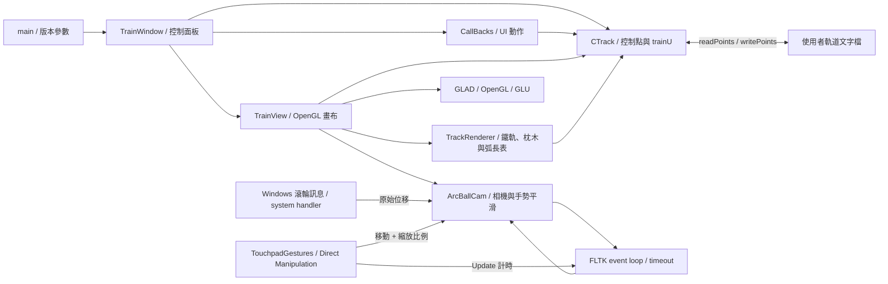

# 架構與資料流

`TrainWindow` 持有場景狀態與 widget；`TrainView` 讀取場景與 UI 選項並繪圖。
`TrackRenderer` 建立累積弧長表，依弧長等距擺放枕木，並以程式產生的像素材質畫方塊風鐵軌；`makeTrackFrame()` 也放在這裡，供列車與相機共用。
`CallBacks` 處理按鈕、軌道載入儲存與列車更新。
`ArcBallCam` 用 FLTK timeout 分攤滑鼠滾輪的整格旋轉與縮放；觸控板的細小位移則立即套用。FLTK 1.3 會把滾輪訊息捨入為整格，因此 `TrainView.cpp` 以 system handler 直接讀取 Windows `WM_MOUSEWHEEL`／`WM_MOUSEHWHEEL` 的原始位移。
`TouchpadGestures` 以 Windows Direct Manipulation 取得精準觸控板的雙指移動與捏合，兩者在同一個手勢中同時送給 `ArcBallCam`；建立失敗時退回滾輪訊息。見 [ADR 0003](adr/0003-touchpad-direct-manipulation.md)。
`Utilities` 包含相機、幾何點與 OpenGL 輔助函式。

軌道格式首行為控制點數，其後每行是位置 `x y z` 與可選方向 `x y z`。
載入後 `trainU` 歸零。個人資料與來源程式分開保存；應以複本驗證讀取與還原。

工程決策見 [ADR 0001](adr/0001-windows-quality-gates.md)。
Clang 工具鏈選擇見 [ADR 0002](adr/0002-clang-cl-build.md)。
