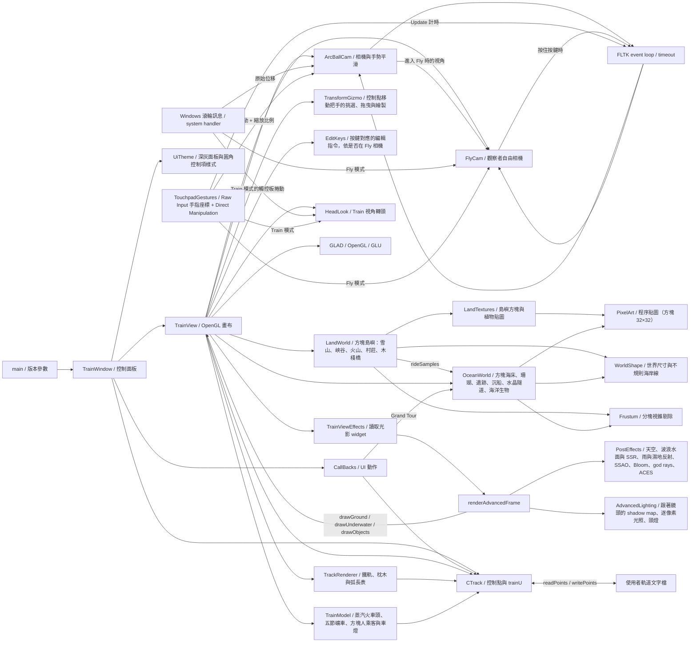

# 架構與資料流

`TrainWindow` 持有場景狀態與 widget；`TrainView` 讀取場景與 UI 選項並繪圖。
`TrackRenderer` 建立累積弧長表，依弧長等距擺放枕木，並以程式產生的像素材質畫方塊風鐵軌；`makeTrackFrame()` 也放在這裡，供列車與相機共用。
`CallBacks` 處理按鈕、軌道載入儲存與列車更新。
`TrainView::handle()` 處理控制點編輯：`TransformGizmo` 以上一幀的相機矩陣做純數學運算（滑鼠射線對軸取最近點、對平面取交點），
不需要 OpenGL context，所以由 `GizmoDragCheck` 測試；編輯進行中的事件會先於相機處理，結果同步到 `Transform` 面板。
哪個鍵是哪個編輯指令由 `EditKeys::forKey()` 決定：Fly 相機下避開所有飛行鍵（複製改 `Alt` + `D`、刪除只留 `Delete`），
所以 Fly 模式的 `handle()` 先問 `editKey()`、再交給 `FlyCam`，飛行鍵不會被編輯搶走，`Home` 取代 `R` 回到 World 視角。編輯開始時 `FlyCam` 停止並解除滑鼠鎖定；編輯中 `editEvent()` 只吃按下，按鍵放開（`FL_KEYUP`）仍交給 `FlyCam`。掃描碼 system handler 也送出 `G`、`R` 與 `Home`，並以 `GetKeyState` 補上修飾鍵狀態，兩條路徑的鍵位一致。`EditKeysCheck` 測試這張對照表與正式 `FlyCam` 不衝突。
`ArcBallCam` 用 FLTK timeout 分攤滑鼠滾輪的整格縮放（左右傾斜為旋轉）；觸控板的細小位移則立即套用。FLTK 1.3 會把滾輪訊息捨入為整格，因此 `TrainView.cpp` 以 system handler 直接讀取 Windows `WM_MOUSEWHEEL`／`WM_MOUSEHWHEEL` 的原始位移。
`FlyCam` 是 Fly 相機按鈕的觀察者模式：記錄位置、yaw 與 pitch（水平線固定），按住移動鍵時以 FLTK timeout 依實際經過時間移動，因此速度單位是每秒世界單位，與幀率無關。每次進入時 `TrainView` 以最後一幀由 World、Train 或 Chase 畫出的 modelview 矩陣（`drawEditOverlay()` 每幀記下）作為起點，所以畫面不跳動；按住 Fly 按鈕的期間 FLTK 已把 Fly 設為開啟、舊相機還沒關，這時重畫的 Fly 畫面不算；上一幀是 Top 正交視角時，改放在 Top 畫面中心（`topViewCentre()`；造景開啟時 Top 以主島與東北陸地的範圍置中）上方、讓同樣寬度的地面填滿畫面的高度往下看。`FOV` 滑桿經 `TrainView::setFieldOfView()` 同時設定 `ArcBallCam`、`FlyCam` 與 Train／Chase 的 `gluPerspective`，視角都相同，所以接續時不需要視角差補償；World 相機重設時的距離依視角換算，維持原本 40 度、250 單位時的取景。失去焦點或切換相機時清除按住的按鍵，避免相機持續漂移。為了不迷失方向，`FlyCam` 把相機限制在場景周圍的方框內（`TrainView` 以 `setGround()` 把最低點設為 y = −200，可以跟著潛到地面以下的軌道），按鍵前進保持水平，並提供平滑的 `lookAt()`（F 鍵轉向列車）；Fly 模式下 `TrainView` 另外畫中央準星，`Light+` 關閉時再畫延伸到地平線的地面（開啟時已有天空與海面），並關閉觸控板放開後的慣性旋轉。操作仿照方塊遊戲的觀察者模式：在畫面點一下後 `TrainView` 隱藏游標、以 `ClipCursor` 限制在畫面內，每次 `FL_MOVE` 把游標相對中心的位移交給 `FlyCam::mouseLook()` 再用 `SetCursorPos` 拉回中心；Esc、失去焦點或切換相機時放開。滑鼠滾輪改變飛行速度。Fly 模式下 `TrainView` 以 `ImmAssociateContextEx` 關閉視窗的輸入法，並另掛一個 FLTK system handler，依 `WM_KEYDOWN`／`WM_KEYUP` 的掃描碼（`FlyCam::keyForScanCode()`）把飛行按鍵直接交給 `TrainView::handle()`，因此注音等輸入法把按鍵變成 `VK_PROCESSKEY` 時，或使用其他鍵盤配置時，按鍵位置仍然有效。
`HeadLook` 是 Train 相機的轉頭：記錄相對於列車的 yaw 與 pitch（yaw 可轉一整圈，pitch 限制在 ±85 度），`TrainView::setProjection()` 先以 `makeTrackFrame()` 取得列車的前方、側面與上方，再由 `HeadLook::apply()` 轉成視線與視線的上方，所以轉頭後畫面仍跟著列車前進與轉彎。Train 模式下 `TrainView::handleTrainLook()` 把左鍵或右鍵拖曳交給 `HeadLook`（不再做控制點點選，因為控制點不顯示），雙擊回正並清除點擊計數，避免下一次按下被當成第三擊；觸控板雙指移動與精準捲動也送給 `HeadLook`，並關閉放開後的慣性；R 鍵沿用 Fly 的掃描碼 system handler，因此注音開著也能回正。
`TouchpadGestures` 以 Raw Input 讀取精準觸控板每根手指的座標，自行把兩指的共同位移與張開比例同時送給 `ArcBallCam`（Fly 模式送給 `FlyCam`：轉頭與前進同時作用）；Direct Manipulation 只負責接手手勢，避免 Windows 另外送出滾輪訊息，並在原始報告不可用時作為備援。見 [ADR 0003](adr/0003-touchpad-direct-manipulation.md)。
`Utilities` 包含相機、幾何點與 OpenGL 輔助函式。

`Light+` 開啟時，`TrainView::draw()` 改呼叫 `renderAdvancedFrame()`：
先從太陽方向把物體畫進 2048² 深度貼圖（shadow map）。陰影範圍跟著鏡頭：以鏡頭前方約 80 單位處為中心、半徑 `kShadowReach`（150 單位），中心以陰影貼圖的格點為單位移動，移動時陰影邊緣不會閃爍，範圍邊緣淡出；Top 正交視角仍涵蓋整個場景。世界再大，陰影的解析度都不變。水面開啟時再以水平面鏡射相機畫一次反射，
接著把場景畫進 16-bit 浮點 frame buffer，依序做 SSAO、濕地反射（下雨時）、水面、雨絲、Bloom 與 god rays，最後 ACES 色調映射到視窗。
水面是跟著鏡頭移動的細分網格：頂點 shader 疊加 Gerstner 波位移，片段 shader 用同一組波的解析法線加上多層捲動噪點；
倒影先在螢幕空間沿反射方向對深度緩衝做光線步進（SSR），沒打中時用平面反射，再依 Schlick 菲涅耳與折射混合。
`Time` 由 `AdvancedLighting::prepare()` 依太陽仰角換算：太陽貼近地平線時陽光是深橘、稍高時金黃、上午後轉白，天空環境光在這段黃金時刻偏暖粉；
天空 shader 在地平線畫一圈帶狀光暈，朝太陽方向是橘金、背向太陽偏玫瑰紫，高處轉藍紫，雲的底部染成金色與粉色。太陽與月亮都是方塊遊戲式的方形，
月亮有 8×8 的深淺斑塊與光暈；太陽下山後改由月亮（在太陽對側升起）投影，月光是偏藍的冷光，搭配藍色的月光環境光，最後輸出的曝光在夜晚略為提高，所以夜景暗但看得清楚。
`Rain` 經 `TrainViewEffects` 緩慢改變 `LightingFrame` 的 `rain` 與 `wetness`：天空轉陰，光照 shader 讓濕表面變暗並提高高光，
水窪遮罩內另以全螢幕 pass 重用同一段 SSR 做鏡面反射，水面法線加上雨滴漣漪。
光照 shader 是 GLSL 1.20，直接讀固定管線的 `gl_Vertex`、`gl_Normal`、`gl_Color` 與 texture unit 0，所以既有 `glBegin` 繪圖程式不需修改；
未綁貼圖時 unit 0 的預設 texture 0 是一個白色 texel。shader 或 frame buffer 建立失敗時自動退回原本畫法。

`Water` 開啟時另外畫 `OceanWorld`：海床是 272×21×272 的方塊格（±680 單位），海底景物、生物路線與遺跡同樣依最初的配置放大，外海小島是沙岸加草地丘陵（水線附近與水面以上只用沙，不露出岩石），建好後以 16×16 欄為一塊各自編成 display list（島外更遠的海床另成一份，永遠畫出）。海床大多深於 y = −15，讓大型生物在上方游；島西側朝夕陽的方向例外，`onShelf()` 圍出一片淺礁台（海床頂在 y = −10），上面鋪一層粉紅、紅、橘為主的珊瑚塊（y = −10 到 −5），離海面約 4 單位，從岸上與列車上透過海水看得到，海洋生物的路線都不經過那裡。珊瑚塊有微弱的自發光（`blockGlow()`），夜晚看得出顏色；淺礁不用黃色珊瑚，因為夜晚的藍色月光會把它照成萊姆綠。
建置時先算 Minecraft 式的光照：天光沿開放的柱子直灌而下、每往旁邊一格少一級，水晶自己發光，
角落再加 ambient occlusion，結果放進 texture unit 1 的座標（x 發光、y 擺動、z 水晶光、w 天光），所以隧道深處自然變暗。
岩拱、閘門與隧道是沿著 `Grand Tour` 的三種 spline 挖出來的，植物另外避開軌道周圍的淨空帶，
`OceanWorld::rideObstructions()` 與測試 `OceanRideClearanceCheck` 用正式的 `CTrack` 取樣檢查列車不會碰到方塊或植物。
魚群、鯊魚、海龜、魟魚、鯨魚與水母每格以方塊即時畫出，大型生物只在景物高度上限之上活動。
牠們的位置是時間的函數，不需保存狀態：沿軌道的魚群取軌道曲線上方的位置（軌道周圍已挖空，必定是開放水域），
開闊水域的魚群與大型生物用幾個週期互不整除的正弦波相加，在各自的橢圓水域內不重複地遊走且不會游出範圍；魚群成員保持隊形並朝同一方向。
光照 shader 對水面以下的像素依深度吸收陽光（紅光最先消失）並乘上 caustics；
鏡頭在水下時改走水下流程：不畫反射，水面改從下方畫（Snell 窗），加上漂浮微粒與氣泡，
再以半解析度沿視線 ray march shadow map 算出光束，最後全解析度套上水霧。
caustics、吸收係數與水體顏色放在 `UnderwaterOptics.h`，三個 shader 共用；水下光束 pass 同時算出頭燈的光錐。

世界的尺寸與海岸線在 `WorldShape`：除了主島，東北方（海底路線不經過的那一側）還有一塊新大陸，中心 (360, −360)、半徑約 150 單位，岸線同樣以雜訊推移，`inlandMain()`、`inlandNorthEast()` 各自傳回離岸距離，`inland()` 取兩者較大者；`LandWorld` 的網格因此不再對稱，欄的範圍是 x −113 到 211、z −212 到 112（`kMinBX` 等常數），只往東北延伸。新大陸的地形由 `northEastSite()` 產生：朝海峽的一側是海平面高度的紅樹林沼澤（`MANGROVE`，泥巴地、沒放水的地方墊到水面高度，所以水窪不會外流，軌道周圍不放水），往東北升成竹林丘陵（`BAMBOO_JUNGLE`）；`plantNorthEast()` 種紅樹（彼此至少隔 7 格，樹冠不連成一片；氣根、樹冠、藤蔓）與竹子（竹節植物一格一格疊高，同一欄位置一致、不擺動，所以連成整根）。`Grand Tour` 在原本陸地段的最後多 15 個控制點，去程經主島北岸與新大陸北側的海面，回程走南邊跨海峽的棧橋，兩段不交叉。最初的配置是 200 單位見方的島、海底路線繞在外圈，現在所有水平距離放大 `kScale`（2.5）倍、海面以上的高度放大 `kLift`（1.5）倍，方塊大小不變，所以每個地標都由更多方塊組成。海岸線是圓角方形（|x|⁴ + |z|⁴ = 250⁴）再以雜訊往內外推移最多 24 單位，`WorldShape::inland()` 傳回離岸距離，陸地與海底共用，所以兩邊吻合。
`Grand Tour` 的控制點定義在 `OceanWorld`（前 25 點是海底段，其後是陸地段），以最初的座標寫成，`trackPoint()` 取用時放大；`OceanWorld::rideSamples()` 把整圈以三種 spline 取樣。
`LandWorld` 用這些取樣點建島：先由雜訊與幾個地形函式（雪山、火山與火山口、岩山、惡地台地與峽谷，皆以最初的座標寫成，`siteAt()` 把世界座標除以 `kScale` 查詢、高度乘 `kLift`，草原、雪山與岩山再疊上小尺度的起伏）算出每一格的高度與生態，
填入方塊後放上熔岩湖與熔岩河（河岸與火山口邊緣的地表依離熔岩的距離轉為岩漿塊）、村莊、池塘、雪山北麓的瀑布峽谷（崖頂溪流、水潭與流到北岸的河，只放水源）與漂浮島，再沿路線挖出淨空管（比列車需要的空間大），在瀑布附近找需要最少地基、整座都在列車淨空外的位置蓋城堡（15×13 格：城牆與城垛、四座角塔、朝瀑布的城門、礫石中庭、木石主堡與 20 格高的主塔，地面有落差時以石頭地基墊起），沿海岸每 3 度找最突出、草原生態、遠離熔岩且離城堡 60 格以上的岬角蓋紅白條紋燈塔（燈室是一圈燈籠）與守塔人小屋，村莊在草地旁第一個有空間的位置蓋教堂與鐘樓；接著在列車看得到、但整片（湖再外推 3 格，因為軌道 6 單位內不能有水）都在淨空外的開闊草原挖一座湖（水面放在四周最低的地面高度，所以不會外溢），蓋一棵巨大的橡樹，並在村莊外圍的平坦草原開幾塊麥田；在雪山腳下（草原與雲杉林交界）找平坦、列車看得到的地方蓋營地：中間的廣場與營火以圓形範圍檢查淨空，四間原木小屋逐棟檢查，至少三間放得下才蓋，整地時跳過列車經過的角落；之後在雪山高處的雪地立冰刺、在惡地台地立風蝕岩柱（下寬上窄的陶土柱，加一層硬帽）。雪山的高度函式加上山脊雜訊（`1 − |2n − 1|`）與岩峰，成為尖峭的山脊；湖周圍 `kGroveRadius` 內的樹都是櫻花並鋪滿花瓣，`drawMoving()` 畫出飄落的花瓣；巨橡樹周圍 `kMeadowRadius` 內少種樹、花成片開成花海；每棟小屋門邊放一盞南瓜燈（`JACK_O`，會發光、照亮四周）；惡地的水池改成黃、橘、紅環帶的溫泉，水潭上架一座兩端都搭在峽谷岩壁上的木橋，
挖剩的薄頂會移除、軌道正下方鋪碎石，有頂的路段在牆上嵌燈籠或水晶。接著 `WaterFlow` 依方塊遊戲的規則讓水從所有水源流開（先往下；旁邊每格水位加一、最多 7；方向權重初始 999，4 格內找得到落差就取最短路徑長度，只往最小權重流；海平面以下由大海吸收），結果寫回每格的水位，水面高度依水位畫出，海面那一層（`kSeaLayer`）用海水色，其餘（含下落的水）都用同一張靜態水貼圖。網格在島外多一圈空格子（`kHalf` = 41，`onIsland()` 判斷），水能從島邊落到海面。水的位置都選在不會靠近軌道的地方，`LandWorld::waterNearRide()` 與 `LandRideClearanceCheck` 確認軌道左右 6、下方 6 到上方 10 單位內沒有水；`WaterFlowCheck` 單獨測試流動規則。最後才種樹與花草（只種在淨空帶之外）。
方塊貼圖由 `LandTextures` 在程式裡逐格畫成 32×32（不讀圖檔）：石頭、圓石、礫石、樹葉用平鋪的雜訊與不規則格子做出塊狀，再依格子邊界加深色輪廓、左上亮邊、右下陰影，明暗分成幾個固定階層，保持像素感；海底的方塊（沙、石、石磚、木板、珊瑚、金塊等）也用同一組函式，只換顏色，海底植物維持 16×16。
光照烘焙與 `OceanWorld` 相同（天光、發光方塊、ambient occlusion）；熔岩與燈籠的暖光寫進頂點顏色與發光量，水晶的冷光用 shader 既有的方塊光。
`LandWorld::rideObstructions()` 與測試 `LandRideClearanceCheck` 用正式的 `CTrack` 取樣，檢查三種 spline 下列車都不會碰到方塊或植物。
島的網格同樣以 16×16 欄為一塊，每塊有自己的方塊、植物與水的 display list 和包住實際方塊的邊界框。`Frustum` 從目前的投影 × modelview 矩陣取出六個平面，`LandWorld::draw()`、`drawWater()` 與 `OceanWorld::draw()` 只畫看得到的塊；因為用的是當下的矩陣，陰影 pass（光源視角）與水面反射 pass（鏡射視角）也自動只畫各自看得到的部分。這讓之後放大世界時，每幀的繪製量只跟畫面裡的範圍有關。`FrustumCheck` 單獨測試剔除的判斷。
水方塊是半透明的靜態水：不遮擋旁邊的面、不擋天光也不算 ambient occlusion，網格另外編成 display list，由 `TrainView::drawStuff()` 在最後畫上：先只寫入水的深度，再在最近的水面上以 alpha 混合畫顏色，所以只看得到水體正面，方塊之間的內部平面與背面不會透出（不進 shadow map，目標的 alpha 保持不變）；挖軌道時被切斷而懸空的水會移除。會動的東西（風車、動物、雲、熱氣球）每格以方塊即時畫出；`TrainView::drawSupports()` 以目前 spline（含 B-spline）每約 1 單位取一點、控制點不變時沿用，交給 `LandWorld::drawSupports()` 每 9 單位規劃一座木棧橋（同一條路線只規劃一次）：
左右兩根柱各自從自己的落點往下找地面（穿過水、立在熔岩裡；島外立在 `OceanWorld::seaFloor()` 的海床上），柱頂貼齊枕木底；只有被另一段軌道擋住的那一根柱不立，兩根都在時才加橫撐。山體也畫進 shadow map，所以會投影。
`Scenery` 關閉時 `LandWorld` 改建平坦的編輯用島；固定管線（`Light+` 關閉）的平面陰影只在這個模式使用。
`Train`／`Chase` 相機由 `TrainView::setProjection()` 從軌道座標系算出；`Chase` 用 `TrainModel::parameterBehind()` 沿軌道往回取最後一節礦車後方的點，抬高後看向火車頭，所以會留在為軌道挖出的空間裡。

軌道格式首行為控制點數，其後每行是位置 `x y z` 與可選方向 `x y z`。
載入後 `trainU` 歸零。個人資料與來源程式分開保存；應以複本驗證讀取與還原。

工程決策見 [ADR 0001](adr/0001-windows-quality-gates.md)。
Clang 工具鏈選擇見 [ADR 0002](adr/0002-clang-cl-build.md)。
