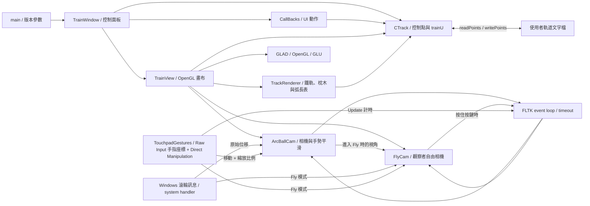

# 架構與資料流

`TrainWindow` 持有場景狀態與 widget；`TrainView` 讀取場景與 UI 選項並繪圖。
`TrackRenderer` 建立累積弧長表，依弧長等距擺放枕木，並以程式產生的像素材質畫方塊風鐵軌；`makeTrackFrame()` 也放在這裡，供列車與相機共用。
`CallBacks` 處理按鈕、軌道載入儲存與列車更新。面板的 FOV 滑桿經 `TrainView::setFieldOfView()` 設定目前相機的視野：World 存在 `ArcBallCam`、Fly 存在 `FlyCam`、Train 存在 `TrainView`，切換相機時滑桿改顯示該相機的值，Top 為正交投影所以停用滑桿。
`ArcBallCam` 用 FLTK timeout 分攤滑鼠滾輪的整格縮放（左右傾斜為旋轉）；觸控板的細小位移則立即套用。FLTK 1.3 會把滾輪訊息捨入為整格，因此 `TrainView.cpp` 以 system handler 直接讀取 Windows `WM_MOUSEWHEEL`／`WM_MOUSEHWHEEL` 的原始位移。
`FlyCam` 是 Fly 相機按鈕的觀察者模式：記錄位置、yaw 與 pitch（水平線固定），按住移動鍵時以 FLTK timeout 依實際經過時間移動，因此速度單位是每秒世界單位，與幀率無關。第一次進入時 `TrainView` 讀回 World 相機的 modelview 矩陣作為起點，並依兩者視角差沿視線移動，使畫面不跳動。失去焦點或切換相機時清除按住的按鍵，避免相機持續漂移。為了不迷失方向，`FlyCam` 把相機限制在場景周圍的方框內（`TrainView` 以 `setGround()` 把最低點設為 y = −200，可以跟著潛到地面以下的軌道），按鍵前進保持水平，並提供平滑的 `lookAt()`（F 鍵轉向列車）；Fly 模式下 `TrainView` 另外畫延伸到地平線的地面與中央準星，並關閉觸控板放開後的慣性旋轉。操作仿照方塊遊戲的觀察者模式：在畫面點一下後 `TrainView` 隱藏游標、以 `ClipCursor` 限制在畫面內，每次 `FL_MOVE` 把游標相對中心的位移交給 `FlyCam::mouseLook()` 再用 `SetCursorPos` 拉回中心；Esc、失去焦點或切換相機時放開。滑鼠滾輪改變飛行速度。Fly 模式下 `TrainView` 以 `ImmAssociateContextEx` 關閉視窗的輸入法，並另掛一個 FLTK system handler，依 `WM_KEYDOWN`／`WM_KEYUP` 的掃描碼（`FlyCam::keyForScanCode()`）把飛行按鍵直接交給 `TrainView::handle()`，因此注音等輸入法把按鍵變成 `VK_PROCESSKEY` 時，或使用其他鍵盤配置時，按鍵位置仍然有效。
`TouchpadGestures` 以 Raw Input 讀取精準觸控板每根手指的座標，自行把兩指的共同位移與張開比例同時送給 `ArcBallCam`（Fly 模式送給 `FlyCam`：轉頭與前進同時作用）；Direct Manipulation 只負責接手手勢，避免 Windows 另外送出滾輪訊息，並在原始報告不可用時作為備援。見 [ADR 0003](adr/0003-touchpad-direct-manipulation.md)。
`Utilities` 包含相機、幾何點與 OpenGL 輔助函式。

軌道格式首行為控制點數，其後每行是位置 `x y z` 與可選方向 `x y z`。
載入後 `trainU` 歸零。個人資料與來源程式分開保存；應以複本驗證讀取與還原。

工程決策見 [ADR 0001](adr/0001-windows-quality-gates.md)。
Clang 工具鏈選擇見 [ADR 0002](adr/0002-clang-cl-build.md)。
