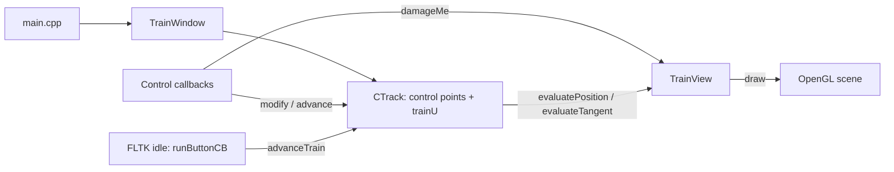

# Roller Coasters 專案技術文件

## 文件目的

本文件供接手者理解目前程式的模組、資料流與座標約定，並說明如何把單一雲霄飛車程式逐步擴充成主題樂園。本文描述的是目前程式狀態；「擴充建議」章節則是後續架構方向。

## 專案結構

| 路徑 | 職責 |
|---|---|
| `src/main.cpp` | 建立 `TrainWindow` 並啟動 FLTK 事件迴圈。 |
| `src/TrainWindow.H/.cpp` | 主視窗與控制面板；持有單一 `CTrack`、相機選項、速度、曲線選擇與列車參數更新。 |
| `src/TrainView.H/.cpp` | OpenGL 顯示區；設定相機與燈光、畫島嶼／軌道／列車、四種相機、處理控制點選取與編輯（把手拖曳、`G`／`R`、復原）。 |
| `src/TrainModel.h/.cpp` | 列車模型：蒸汽火車頭加五節木頭礦車（每節一位方塊人乘客）與車燈，各節沿弧長往後取位置；也提供 `Chase` 相機用的列車長度與沿軌道往回取點。 |
| `src/LandWorld.h/.cpp`、`src/LandTextures.h/.cpp` | 方塊島嶼：地形生成（雪山、峽谷、火山、岩山、村莊）、沿 `Grand Tour` 挖出淨空、光照烘焙、會動的景物與木棧橋；貼圖在程式中畫出。 |
| `src/TransformGizmo.h/.cpp` | 控制點移動把手：挑選、拖曳換算與繪製。 |
| `src/EditKeys.h/.cpp` | 控制點編輯的鍵位表，Fly 相機下避開飛行鍵。 |
| `src/UiTheme.h/.cpp` | 控制面板的配色與自訂圓角樣式。 |
| `src/Track.H/.cpp` | 控制點容器、樣條位置與切線計算、列車參數 `trainU`、軌道文字檔讀寫。 |
| `src/TrackRenderer.H/.cpp` | 方塊像素風鐵軌與枕木的繪製、程序式材質、弧長表與 `makeTrackFrame()`。 |
| `src/ControlPoint.H/.cpp` | 控制點的位置和方向向量，以及控制點標記的繪製。 |
| `src/CallBacks.H/.cpp` | FLTK 按鈕、滑桿、閒置更新及控制點編輯事件。 |
| `src/Utilities/Pnt3f.*` | 基本三維向量／點型別。 |
| `src/Utilities/ArcBallCam.*` | World 相機的滑鼠環視操作。 |
| `src/Utilities/FlyCam.*` | Fly（觀察者）相機：鍵盤、拖曳與觸控板自由移動。 |
| `src/Utilities/3DUtils.*` | OpenGL 顯示、地板、陰影等輔助函式。 |
| `CMakeLists.txt` | CMake 專案、原始碼清單、FLTK／OpenGL 連結設定。 |

## 目前的物件與資料流

程式目前以單一 `TrainWindow::m_Track` 表示整個世界中的一條軌道與一台列車。控制面板 callback 直接修改這份狀態，之後呼叫 `damageMe()` 要求顯示區重畫。自動行駛由 FLTK idle callback 定期呼叫 `advanceTrain()`。



一幀大致依序進行：清除緩衝、建立相機投影、設定燈光、畫地面與場景物件、畫控制點／軌道／列車；World、Train 與 Fly 視角另外呼叫陰影繪製流程。各視角由 `TrainView::setProjection()` 選擇。

## 軌道與列車的數學約定

### 座標系與參數

- 世界座標以 **Y 軸朝上**；地面位於接近 `y = 0` 的平面。
- 預設控制點位於 `y = 5` 附近。控制點位置使用世界座標。
- `trainU` 是樣條參數，不是世界距離。每一整數區段對應一個控制點區段；參數會按控制點數量循環回繞。
- 列車模型的本地 **+Z 軸代表車頭方向**。

### 樣條類型

`CTrack::evaluatePosition(u, type)` 會先把 `u` 回繞到閉環範圍，取出目前區段附近四個控制點，再依選取類型計算位置：

- **Linear**：在區段兩端控制點間線性插值。
- **Cardinal Cubic**：使用 Catmull-Rom 形式的均勻三次曲線，通過控制點。
- **Cubic B-Spline**：使用均勻三次 B-Spline 基底，曲線平滑並逼近控制點；這是預設選項。

三種曲線共用參數週期和閉環索引，因此最後一個區段會連回第一個區段。若控制點少於四個，位置計算回傳原點；正常編輯操作會維持至少四點。

### 切線、車體方向與相機

`evaluateTangent()` 以 `u ± 0.001` 的位置差分估算切線並正規化。`makeTrackFrame()` 以切線作本地前方，計算側向與本地上方。車體、雙軌偏移和 Train 鏡頭共用這個方向框架。Train 鏡頭從列車位置上方和前方取眼睛位置，朝切線方向觀看。

這種以世界上方協助建立方向框架的做法，適用於一般起伏軌道；若軌道包含完整翻轉或連續迴圈，側向可能突然翻轉。擴充翻轉軌道時，建議改用平行傳輸（parallel transport）框架，避免只依賴世界上方。

### Fly 觀察者相機

`FlyCam` 以眼睛位置、yaw（0 度朝 -Z，向右為正）與 pitch（限制在 ±89 度）描述相機，前方向量為 `(sin yaw·cos pitch, sin pitch, -cos yaw·cos pitch)`，用 `gluLookAt` 搭配世界上方建立視圖，因此水平線永遠水平。W／S 沿水平前方 `(sin yaw, 0, -cos yaw)` 移動，A／D 只在水平面平移，E／Q 沿世界上方升降；捏合與滾輪沿完整視線方向前進。每次移動後把眼睛限制在 `y ∈ [−200, 400]`、`|x|, |z| ≤ 400`；最低點由 `TrainView` 以 `FlyCam::setGround()` 設定，讓潛到地面以下的軌道也能跟著看。按鍵沿用方塊遊戲觀察者模式的配置：W／A／S／D 水平移動、空白鍵上升、Shift 下降、Ctrl 加速；滑鼠滾輪每格把速度乘或除 1.25。滑鼠看由 `TrainView` 擷取游標：游標隱藏並每次移動後拉回畫面中心，位移乘 0.15 度／像素交給 `FlyCam::mouseLook()`。`lookAt()` 算出目標 yaw／pitch，yaw 取 ±180 度內的短邊差，在 0.35 秒內以 smoothstep `t²(3 - 2t)` 內插。按住按鍵時以約 60 Hz 的 FLTK timeout 依實際經過時間 `dt` 移動（單步最多 0.1 秒），速度為每秒世界單位。

每次切到 Fly 時，`TrainView` 讀回上一幀實際畫出的 modelview 矩陣 `[R|t]`（World、Train、Chase 任一相機）：眼睛位置為 `-Rᵀt`，前方為 R 第三列取負。所有透視相機共用 `FOV` 滑桿的視角（預設 70 度，可調 30–120 度），所以不需要沿視線補償，畫面完全接續；只有 Train 相機隨軌道的傾斜（roll）會擺正。上一幀是 Top 正交視角時沒有眼睛位置，改放在島中央上方、高度為「畫面半高 ÷ tan(視角 / 2)」處往下看。`FlyCam::setFromViewMatrix()` 仍保留視角差補償的參數，`FlyCamCheck` 照舊測試。

### 移動與弧長近似

Run 模式由 idle callback 約每秒 30 次呼叫 `advanceTrain()`；左右箭頭呼叫同一函式，以正負方向手動移動。速度滑桿決定每次更新的移動量：

- ArcLength 開啟時，程式沿參數小步前進，累加相鄰曲線位置的歐氏距離，直到達到指定距離；這是每次呼叫即時計算的數值近似，並非預先建立弧長查表。
- ArcLength 關閉時，每次更新直接改變 `trainU`，因此世界空間速度會隨曲線區段長度改變。

若加入多台列車或複雜遊樂設施，建議把更新改成傳入實際時間差 `dt`，使速度與畫面更新率分離；弧長移動則可改用快取的參數／累積距離表。

## 繪製與控制點編輯

- 軌道由 `src/TrackRenderer.*` 繪製，走方塊像素風：方形截面的鐵軌，以及有厚度的木枕。兩者的 16×16 材質在程式啟動後由程式碼產生（不讀外部圖檔），放大時用 nearest 取樣，保留一格一格的像素感；縮小時用 mipmap 避免閃爍。
- 繪製前先建立累積弧長表（每個參數區段 48 個取樣點），再用二分搜尋把弧長換回參數 `u`。枕木數量取「總長 ÷ 1.5」四捨五入，所以整圈間距完全相同，包括閉環接縫處；與控制點分佈和曲線類型無關。`tests/TrackSpacingCheck.cpp` 以更細的取樣獨立量測相鄰枕木間的弧長，確認誤差在 2% 以內。
- 鐵軌是沿曲線掃出的四面方柱，材質座標依弧長前進，接縫標記每 4 單位出現一次。陰影階段只送出幾何，不設定顏色或材質。
- 樹木是 `TrainView.cpp` 中固定座標的程序式樹幹與兩層樹冠，並進入一般物件／陰影繪製流程。
- 列車目前是一節簡單方塊車體；橘紅色端代表車頭。`ControlPoint::orient` 可編輯並存檔，但目前列車框架由曲線切線決定，不使用各控制點方向向量。
- 點選控制點後可拖曳位置；新增點會在選取點與下一點之間插入中點，未選取時插在閉環尾端。刪除操作保留至少四點。
- 軌道文字檔第一行是控制點數；後續每行是 `x y z`，或 `x y z orientX orientY orientZ`。未提供方向時使用 `(0, 1, 0)`。

## 加入主題樂園內容的建議

目前 `TrainWindow` 直接持有單一 `CTrack`，而 `TrainView::drawStuff()` 直接列出軌道、樹木和列車。這種寫法適合單一作業場景；新增多條軌道、遊樂設施和大量景物前，建議先把「世界狀態」與「場景物件」抽出來。

### 建議目標架構

```text
ParkWorld
  tracks: Track collection
  rides: Ride collection
  scenery: SceneObject collection
  paths / terrain / lights

Ride
  update(dt)
  draw(renderPass)

CoasterRide
  Track + vehicles + station state

CarouselRide / FerrisWheelRide
  ride-specific animation state

SceneObject
  transform + geometry/material + draw(renderPass)
```

這是擴充方向，不是目前已存在的類別。可以分階段導入：

1. **抽出 `ParkWorld`**：把 `m_Track` 和場景狀態從視窗移出；視窗保留 UI，callback 對世界模型下命令。
2. **允許多條軌道與多台車**：每個 ride 擁有自己的軌道、車輛參數、速度與運轉狀態；車輛用軌道 ID 找到所屬路徑。
3. **建立可更新／可繪製物件**：把樹、建築、路燈、長椅、入口等從 `drawStuff()` 的固定呼叫改成物件集合，支援位置、旋轉與縮放。
4. **新增設施類型**：摩天輪、旋轉木馬等各自實作更新狀態和幾何，不要把特定設施的邏輯塞進 `TrainView`。
5. **加入園區資料檔**：保存多條軌道、設施種類、位置／方向／尺寸和景物；軌道控制點檔可先作為子格式沿用。
6. **控制與相機依物件選取**：選取園區物件後顯示其屬性；相機目標可切換到設施或車輛。

### 新增一種設施時的修改位置

建議新增 `src/Rides/` 或 `src/Scene/` 下的類別檔，將設施資料與繪製放在類別內；在 `ParkWorld` 建立和更新設施；最後再於控制面板增加建立／選取介面。若只是新增靜態裝飾，則建立通用場景物件資料後放入場景集合，不要每新增一棵樹就再加一個硬編碼的 `drawTree()` 呼叫。

## 建置環境

專案使用 CMake 3.16 以上、C/C++、FLTK 以及系統 OpenGL／GLU。FLTK 標頭和 MSVC `.lib` 檔位於專案的 `include/` 與 `lib/`；目前 CMake 設定是 Windows/MSVC 取向，轉到其他作業系統時需調整函式庫連結與平台相依程式碼。
